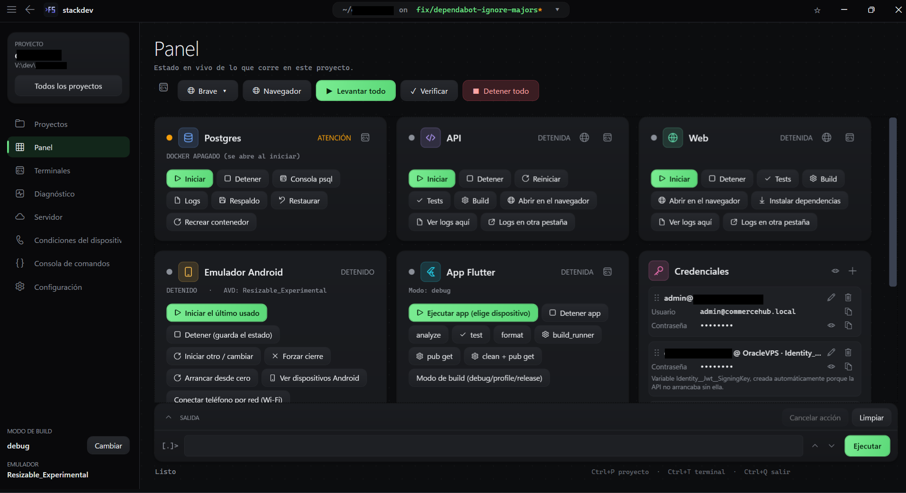
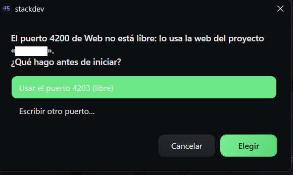
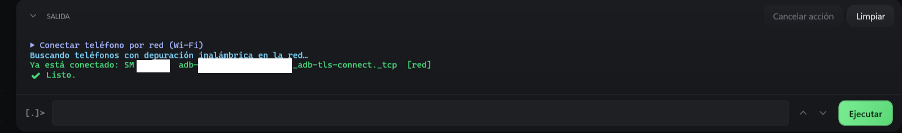
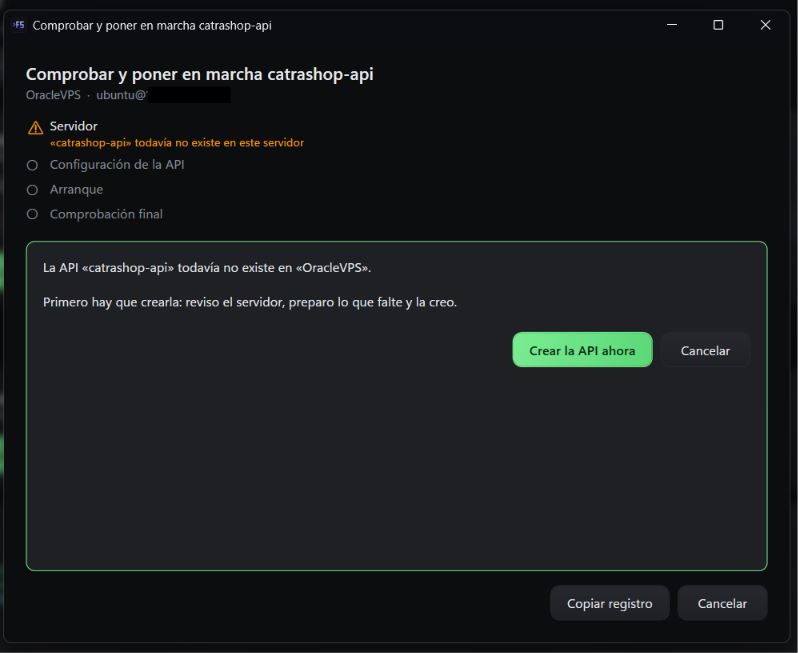

# stackdev

[Español](README.es.md) · **English**

One tool to run and ship a local full-stack project: start the database, the API, the web app and the emulator with one click, then put the API on your own server (VPS) without opening a terminal.

It started as a PowerShell menu for a **.NET API + Angular web + Flutter app + Postgres in Docker** stack, and is growing into a toolbox for projects in any language.

> **Status:** used every day on Windows. A first cross-platform window ([`stackdev-app`](#cross-platform-window-preview), Avalonia) runs on Windows, Linux and macOS with the local services only; the full window is still WPF (Windows). See the [roadmap](#roadmap).

## What it does

**Local development**
- Detects what a project is made of (API, web, mobile, database) and writes a small `dev-menu.json` for it. .NET, Angular and Flutter are built in; **Node (NestJS, Express, Fastify, Next, Nuxt, SvelteKit, Vite, CRA, Vue CLI) and Python (Django, FastAPI, Flask)** come from [profiles](CONTRIBUTING.md#project-profiles), plain JSON files anyone can add.
- One panel with live status and buttons for every service: *Start all*, *Check*, *Stop all*, logs, device conditions, a command console.
- **Busy ports are caught before starting.** If the API or web port is held by another process, a container, another project or a Windows reservation, you are told who has it and choose: the next free port (saved in the config), a port you type, close the process, or use it as it is. `dotnet run` and the web dev server follow the port you picked, and a web proxy that points to another API port is corrected with a temporary copy, never by editing your files.
- **Services that stop to ask something are noticed.** A service started in the background cannot answer a prompt such as pnpm's *"remove node_modules? (Y/n)"*; the card shows *waiting for your answer* with the question and offers to continue in a terminal.
- **Mobile app and phones.** Running the app asks which API it talks to (this PC, your server or any address). Phones with wireless debugging (Android 11+) are found on the network and connected without typing an IP and port; pairing needs only the six-digit code.
- **Moved or renamed a project folder?** *Relocate* takes its configuration and history to the new folder, and a project's configuration can be copied to another one.
- A command-line version (`stackdev up`, `stackdev api start`, …) for scripts, with proper exit codes.

**Deploy to your own server** (SSH, nothing to install on the server)
- **Upload API**: publishes the project, refuses development files and secrets, uploads a checksummed package, keeps a backup, swaps it in, waits until the service is healthy and rolls back by itself if it is not. A build the server already runs is not uploaded again.
- **Create an API**: user, folders, `.env` with generated secrets, systemd service, Apache or Nginx site, firewall and HTTPS certificate. Installs what is missing (runtime, web server, PostgreSQL) and creates one database and user per API.
- **Try before replacing**: the new version is started on a spare port with the real settings; missing settings are found and fixed before anything changes.
- **Diagnose and repair**: looks at the public address from the outside (service, ports, DNS, certificate, answer) and offers a one-click repair, such as recreating a missing web site.
- **Edit the server's `.env`** with hidden secrets and automatic restore if the service stops starting.

Everything is guided with forms in one window. Every remote command has a time limit and a Cancel button, so nothing waits forever.

## Screenshots



| Busy port | Phones over Wi-Fi | Upload API |
|---|---|---|
|  |  |  |

## Download

Get `stackdev-gui-<version>-win-x64.exe` from the [latest release](https://github.com/davidtriminio/stackdev/releases/latest) and run it. It already includes .NET, so there is nothing else to install. It needs Windows 10 or 11 (64-bit); the integrated terminal uses Microsoft Edge WebView2, which comes with Windows 11 and with Edge on Windows 10.

The file is not code-signed yet, so Windows SmartScreen may show "Windows protected your PC". Choose *More info*, then *Run anyway*. The source is in this repository if you prefer to build it yourself.

Open your project's folder and press *Start all*.

## Safety

- The server's SSH fingerprint is pinned in a private `known_hosts`; connections go ahead only if it matches (`StrictHostKeyChecking=yes`).
- Secrets are masked in every log. The server list and the generated credentials are encrypted at rest (Windows DPAPI today).
- The publish guard blocks `.env`, `appsettings.Development.json`, keys and local databases from being uploaded.
- The server needs a user with passwordless `sudo`; nothing else is installed there beyond what you approve.

## Requirements

- Windows 10/11 and the .NET SDK 10 (`dotnet --list-sdks` shows `10.x`).
- For the parts you use: Docker Desktop, the Android SDK, Flutter, pnpm/npm, an OpenSSH client.

## Build and run

```powershell
git clone https://github.com/davidtriminio/stackdev
cd stackdev
dotnet test                                   # core tests
dotnet run --project src/StackDev.Gui         # the window
dotnet run --project src/StackDev.Cli -- status   # the command line
```

### Cross-platform window (preview)

Needs only the .NET SDK 10, on Windows, Linux or macOS:

```bash
dotnet run --project src/StackDev.App
```

Open a project folder and it shows the API and web services with their state and start, stop, restart, open and log actions. The core and this window are built and tested on Windows, Ubuntu and macOS in CI, but the window has been tried by hand only on Windows so far. Not in it yet: Postgres/Docker, the emulator and the mobile app, terminals, credentials and deploying to a server. Outside Windows secrets are not encrypted yet (no system keychain), which is why the credentials and servers parts are left out.

Single-file build of the window, self-contained (the release file; much larger than one that needs the .NET runtime):

```powershell
dotnet publish src/StackDev.Gui -c Release -r win-x64 --self-contained true -p:PublishSingleFile=true -p:EnableCompressionInSingleFile=true -p:DebugType=none -o publish\selfcontained
```

Add `--self-contained false` (and drop the compression option) for a small file that needs the .NET 10 Desktop Runtime installed.

Install the command line as a .NET tool:

```powershell
dotnet pack src/StackDev.Cli -c Release
dotnet tool install -g stackdev --add-source .\nupkg
```

The remote script has its own tests (they run on Linux, WSL or Git Bash): `bash tests/remote/remote-script.test.sh`.

## Project layout

```
src/StackDev.Core   logic without UI: config, detection, processes, Docker, SSH, deploy engine
src/StackDev.Cli    commands and the console screen
src/StackDev.Gui    the window (WPF, dark "Forja" theme)
src/StackDev.Core/Deploy/Remote/stackdev-remote.sh   the script that runs on the server
tests/              xUnit tests for the core and a shell suite for the remote script
examples/           a complete dev-menu.json
```

The remote script talks to the app with a line protocol (`##STEP`, `##INFO`, `##WARN`, `##FAIL code msg`, `##KV key=value`, `##DONE`) and uses documented exit codes.

## `dev-menu.json`

A project describes itself in one optional-everything file at its root: `postgres`, `api`, `web`, `mobile`, `startAll`, `tasks` and `deployment`. Missing sections simply do not appear in the UI, and unknown fields are kept when the file is saved. See [examples/dev-menu.json](examples/dev-menu.json) for a complete file; the Spanish [README](README.es.md) has the full field table.

## Roadmap

Planned, in this order:

1. **Cross-platform**: *started.* The Avalonia window and the core already build and test on Linux and macOS. Next: Postgres/Docker and terminals in that window, a system keychain instead of DPAPI so credentials and servers can move over, then deploying from it.
2. **Language support as data**: *started.* Profiles describe how to detect, start, test and build a project type, so adding a language needs no C#; Node and Python ship today and `examples/profiles/go.json` shows how to add Go. Next: more built-in profiles (Go, Java, PHP, Rust) and publishing, which is still .NET-only.
3. **More targets**: web (Vercel or your server), Android APK, database backup and restore.

## Contributing

Issues and pull requests are welcome. Read [CONTRIBUTING.md](CONTRIBUTING.md) first; it is short. Security problems: see [SECURITY.md](SECURITY.md).

## License

[MIT](LICENSE) © David Triminio
